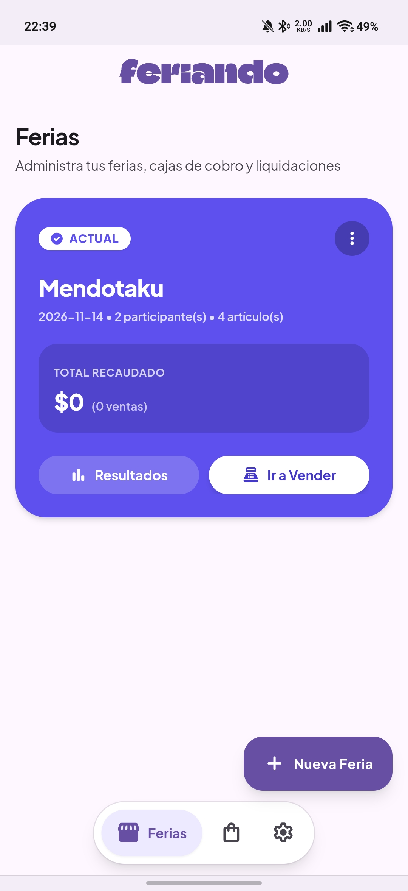
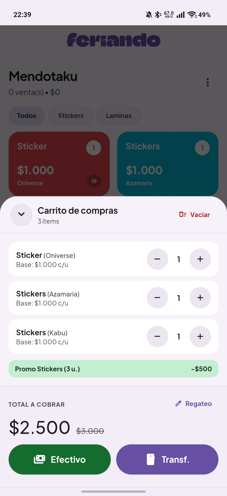

<div align="center">
  
  <h1>Feriando</h1>
  <p>
    <strong>Punto de venta offline-first para ferias con prorrateo inteligente y liquidación automática.</strong>
  </p>

  <p>
    <a href="https://oniversedesign.github.io/Feriando/">
      
    </a>
    <a href="https://oniversedesign.github.io/Feriando/">
      
    </a>
    <a href="LICENSE">
      
    </a>
    <a href="https://cafecito.app/oniverse">
      
    </a>
  </p>

  <p>
    
    
    
    
  </p>
</div>

---

## ¿Qué es Feriando?

**Feriando** es una aplicación web progresiva (**PWA**) diseñada para emprendedores y stands compartidos en ferias. Permite registrar ventas al instante desde el celular o la computadora **sin necesidad de conexión a internet**, aplicar promociones combinables (*Mix & Match*) repartiendo el monto exacto entre cada dueño, cargar gastos y calcular automáticamente la liquidación final al cierre del evento.

---

## Capturas de pantalla (Versión móvil)

<div align="center">

| Mis Ferias | Configurar Feria | Feria Actual (Caja) | Carrito | Compra Registrada |
| :---: | :---: | :---: | :---: | :---: |
|  |  |  |  |  |

</div>

---

## Características principales

- **100% Offline-First e instalable (PWA):** Todos los datos se guardan localmente en el dispositivo (`localStorage`). Funciona sin señal en parques o predios y puede instalarse en la pantalla de inicio en Android, iOS y escritorio.
- **Gestión de Ferias (Eventos):** Crea múltiples eventos, márcalos como activos o finalizados y duplica ferias anteriores conservando participantes, entidades compartidas, familias promocionales y catálogo de productos.
- **Participantes y Entidades Compartidas:** Distingue entre participantes individuales (con color identificatorio) y entidades compartidas (por ejemplo, una marca conjunta) con porcentajes de reparto configurables.
- **Prorrateo Inteligente (*Mix & Match*):** Agrupa productos en familias promocionales con escalas por cantidad (ej. 1x, 2x, 3x). Al cobrar, la app prorratea el precio promocional de forma exacta entre los dueños de cada ítem del carrito.
- **Punto de Venta (POS) ágil:**
  - Carrito rápido pensado para usar con una mano en el stand.
  - Control de stock opcional por producto.
  - Cobros en **Efectivo** (pozo común) o **Transferencia** (por participante individual o hacia una cuenta única).
- **Gastos y Liquidación Automática:** Registra gastos pagados por cualquier participante (divididos en partes iguales o porcentajes personalizados) y obtén al instante el balance neto y quién debe transferirle a quién para saldar cuentas.
- **Respaldos y Exportación:** Exporta e importa todas tus ferias en formato **JSON** para resguardar o mover tus datos entre dispositivos, y exporta reportes de resultados.
- **Diseño Material 3:** Tema claro, oscuro o automático según el sistema, selector de paleta de colores M3, respuesta háptica opcional y confirmación de borrado.

---

## Cómo se usa

1. **Abre la aplicación:** Ingresa a **[Feriando en GitHub Pages](https://oniversedesign.github.io/Feriando/)** (o instálala como PWA desde el menú de tu navegador).
2. **Crea una nueva feria:** Toca en **Crear nueva feria** y asigna un nombre y fecha.
3. **Configura participantes y catálogo** (pestaña **Configuración**):
   - Agrega a los participantes del stand y, si corresponde, entidades compartidas con su porcentaje de reparto.
   - Define el modo de transferencias (cuenta individual por participante o cuenta única).
   - Crea familias promocionales si vendes combos (ej. stickers o pines 3x) y carga tus productos.
4. **Registra ventas en vivo** (pestaña **Vender / POS**):
   - Toca los productos para sumarlos al carrito; las promociones se aplican automáticamente.
   - Selecciona **Efectivo** o **Transferencia** y confirma el cobro.
5. **Carga gastos y consulta resultados** (pestaña **Resultados**):
   - Agrega los gastos del evento (mesa, traslado, bolsas, etc.).
   - Al terminar la feria, revisa el resumen por participante y las transferencias sugeridas para liquidar el evento.
6. **Guarda un respaldo:** Desde **Ajustes**, puedes exportar un archivo `.json` con toda tu información en cualquier momento.

### Instalar en tu dispositivo (PWA)
- **Android (Chrome):** Menú `⋮` → *Instalar aplicación* o *Agregar a la pantalla principal*.
- **iPhone / iPad (Safari):** Botón *Compartir* → *Agregar a inicio*.
- **PC / Mac (Chrome o Edge):** Ícono de instalación en la barra de direcciones.

---

## Reportar errores y sugerencias

¿Encontraste un fallo o tienes una idea para mejorar Feriando? Puedes enviarlo directamente desde GitHub:

- **[Reportar un error (Bug)](https://github.com/OniverseDesign/Feriando/issues/new?template=bug_report.yml)**
- **[Sugerir una mejora o función](https://github.com/OniverseDesign/Feriando/issues/new?template=feature_request.yml)**
- **[Ver todos los Issues](https://github.com/OniverseDesign/Feriando/issues)**

Si quieres colaborar con código, revisa la [Guía de Contribución](CONTRIBUTING.md).

---

## Desarrollo local

Requisitos: **Node.js 20+** y **npm**.

```bash
# 1. Clonar el repositorio
git clone https://github.com/OniverseDesign/Feriando.git
cd Feriando

# 2. Instalar dependencias
npm install

# 3. Iniciar servidor de desarrollo
npm run dev

# 4. Ejecutar pruebas unitarias
npm test

# 5. Generar build de producción
npm run build
```

---

## Apoya el proyecto

Si **Feriando** te resulta útil en tus ferias y emprendimientos, puedes invitar un cafecito para apoyar su mantenimiento y nuevas funciones:

<a href="https://cafecito.app/oniverse">
  
</a>

---

## Autor y Licencia

Desarrollado por **Oniverse** ([OniverseDesign](https://github.com/OniverseDesign)).
Distribuido bajo la licencia [MIT](LICENSE).
